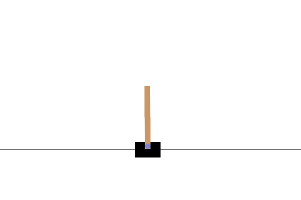
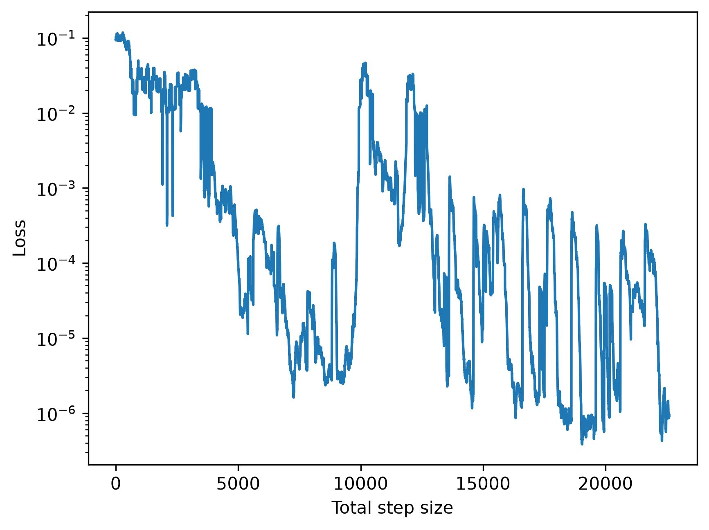
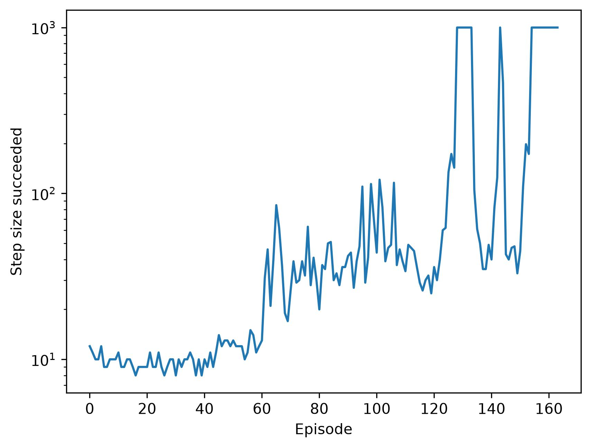

# Deep Q Network (DQN) for CarPole-v1



## Easy Explanation

1. Proceed a step
1. Stock state, action, reward, and next state in a buffer
1. Train Q function with the buffer as batch

## Usage Example

```bash
uv run main.py
```

## Results





## Grateful References

[ITエンジニアのための強化学習理論入門](https://gihyo.jp/book/2020/978-4-297-11515-9)
